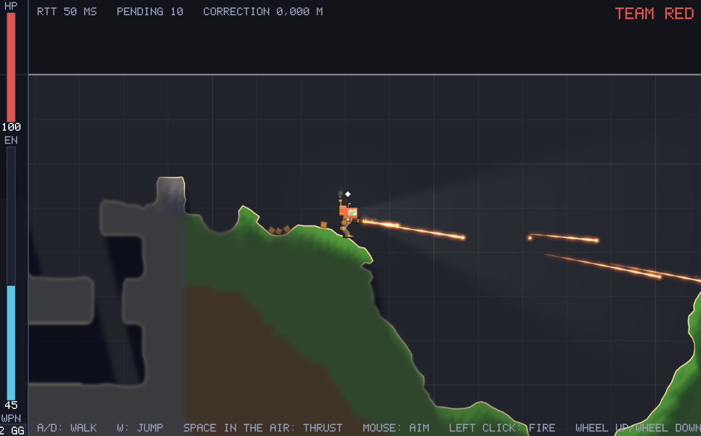

# RumbleMechs

A multiplayer 2D mech game: steam-powered mechs, destructible ground, grenades and gatling guns, played in teams
over the internet.

> **Early alpha.** This is an early alpha version: expect bugs, missing features and things changing between
> builds. It is free to download and play during the alpha, but RumbleMechs will **not** be free once it is released.

This repository only holds the game for download. The game's source is not public.

**Join the community on [Discord](https://discord.gg/YaeqsPCvM)**: find people to play with, report bugs and suggest
ideas.

## The game

- **Destructible terrain.** Every grenade and every round takes a bite out of the ground. Grass gives way easily,
  dirt less so, rock hardly at all. Blast through hills, open up tunnels, or dig out the ground under someone's feet.
- **Real physics.** Mechs, crates, grenades and rounds all move by the same physics: blasts throw things about,
  crates topple and stack, grenades bounce and roll down slopes, and a mech that is destroyed blows up and takes the
  ground with it.
- **Digging and building.** The ground is yours to reshape: dig your way through it, carve out tunnels and bunkers,
  or build walls and cover where you need them.
- **See only what your team sees.** What the ground hides is in the fog: you know the lay of the land, but not who is
  in it, until you or a teammate gets a look.
- **Mechs with steam and thrusters.** Walk, jump and fly on your thrusters, firing grenades or a gatling gun, on an
  energy budget that both share.

## Download and play

**[Download the latest version for Windows](https://github.com/SyntaxWarrior/RumbleMechs/releases/latest/download/RumbleMechs-win-x64.zip)**

1. Unzip it anywhere.
2. Start `RumbleMechs.exe`.
3. Pick a server from the list and play.

Nothing else needs installing. Your name in the game is your Windows user name; to choose another, start it from a
command prompt with the name after it: `RumbleMechs.exe MyName`.

Windows may warn that the program is from an unknown publisher, since it isn't signed. Choose **More info** and then
**Run anyway**.

### Controls

| | Keyboard and mouse | Gamepad |
|---|---|---|
| Walk | A / D | Left stick |
| Jump | W or Space | A |
| Thrusters (in the air) | Hold Space | Hold A |
| Aim | Mouse | Right stick |
| Fire | Left click | Right trigger |
| Change weapon | 1 / 2 or mouse wheel | LB / RB |
| Menu | Esc | Start |

## License

The alpha is free to download and play, but RumbleMechs is not open source, and the finished game will not be free:
see [LICENSE.txt](LICENSE.txt). It includes third-party components under their own licenses: see
[THIRD-PARTY-NOTICES.txt](THIRD-PARTY-NOTICES.txt).

Copyright (c) 2026 Jens Berfenfeldt. All rights reserved.
