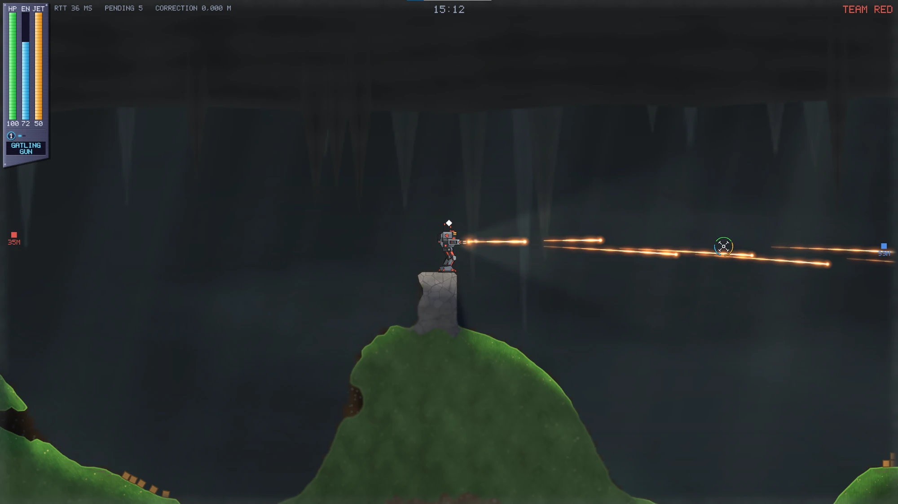
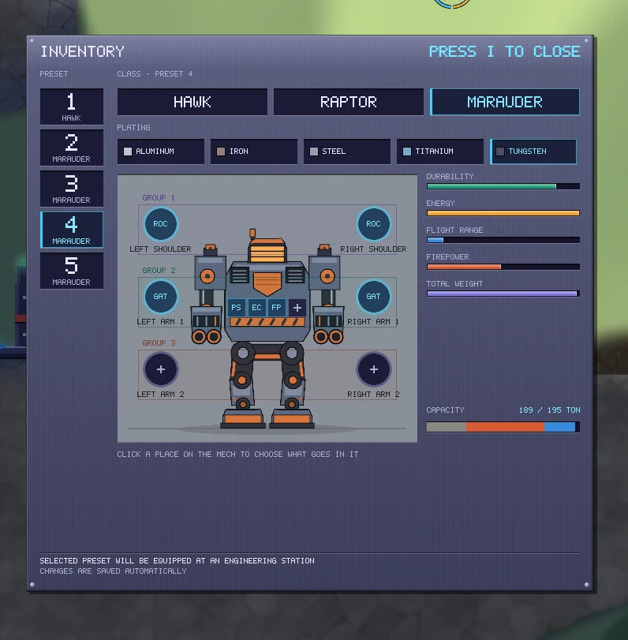
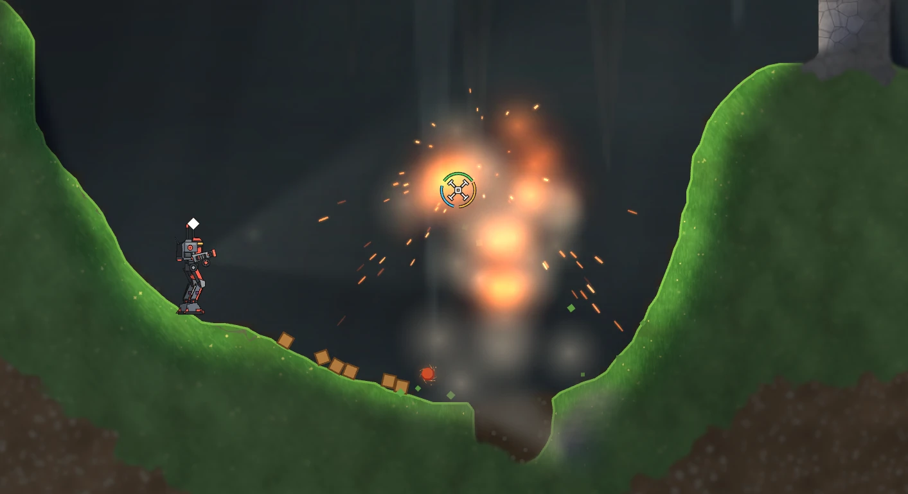
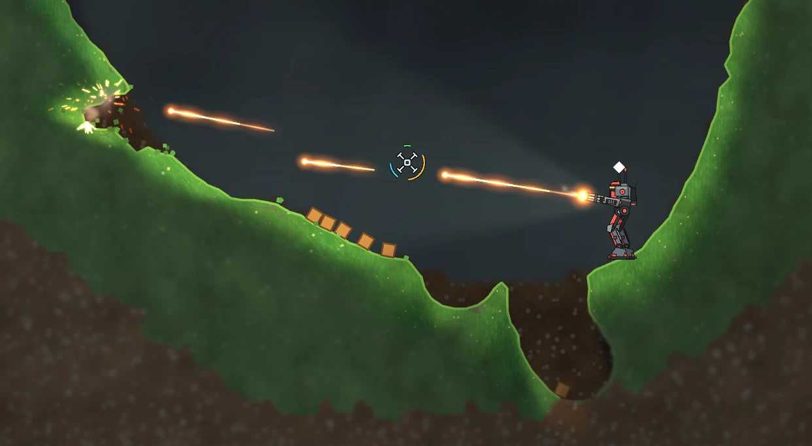
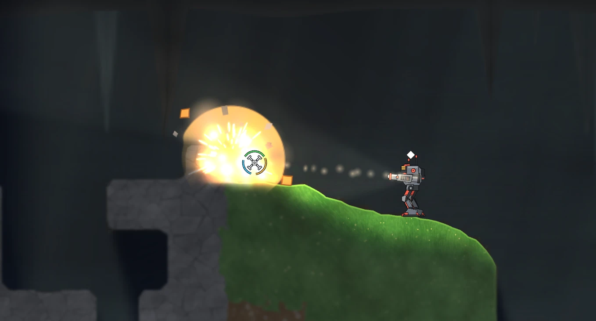
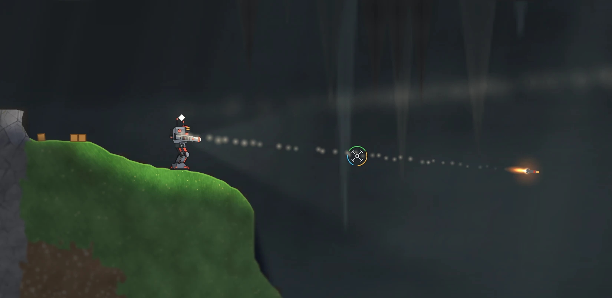

# RumbleMechs

RumbleMechs is a 2D side-scrolling multiplayer team PvP mech game with destructible terrain. Your team of mechs battles another team for dominance. Blast through hills, dig under the enemy's defenses, and build your own.



> **Early alpha.** The game is in early development: expect bugs, missing features and things changing between builds. It is free to download and play during the alpha, but RumbleMechs will **not** be free once it is released.

This repository only holds the game for download. The game's source is not public.

**Join the community on [Discord](https://discord.gg/YaeqsPCvM)**: find people to play with, report bugs and suggest
ideas.

## Features

### In the game now

- **Multiplayer.** Play with up to 16 people in team-based Capture the Flag.
- **Fully destructible terrain.** Dig tunnels and surprise your enemy! Create a secret tunnel right into the enemy base.
- **Physics.** Mechs, crates, grenades and rounds all move by the same physics. Blow a hole in
  a wall and lob grenades through it.
- **Fog of war.** Vision is shared by the team. If the enemy can't see you, they don't know what you are doing. Maybe you are digging a tunnel right under their base.
- **Your own loadout.** Build your mech to suit your playstyle: heavy or light, machine guns or grenade launchers. But you only have so much space, and being heavy is not always the best choice.





### Planned

- **Bases to build and defend.** Place generators, turrets and shields to protect your base, and break through the
  enemy's.
- **More weapons.** Destroy things even faster, with bigger explosions and grenades that build walls of dirt to block your enemies.
- **More maps.** Several more of them.

## Screenshots







## Download and play

You download a small launcher with the game inside. Every time you start it, the launcher checks for a new version,
installs it and then starts the game, so you only have to download once.

**Windows:** **[RumbleMechs-win-x64.zip](https://github.com/SyntaxWarrior/RumbleMechs/releases/latest/download/RumbleMechs-win-x64.zip)**

1. Unzip it anywhere.
2. Start `RumbleMechsLauncher.exe`.
3. Pick a server from the list and play.

Windows may warn that the program is from an unknown publisher, since it isn't signed. Choose **More info** and then
**Run anyway**.

**Linux** (64-bit, with a desktop and OpenGL): **[RumbleMechs-linux-x64.tar.gz](https://github.com/SyntaxWarrior/RumbleMechs/releases/latest/download/RumbleMechs-linux-x64.tar.gz)**

```bash
tar -xzf RumbleMechs-linux-x64.tar.gz
cd RumbleMechs
./RumbleMechsLauncher
```

If it won't start, make it runnable first: `chmod +x RumbleMechsLauncher game/RumbleMechs`

Nothing else needs installing. Type the name you want to play under in the box above the server list (click it or
press Tab); it is kept for the next time, in `settings.yaml` in the `game` folder. All builds are on the
[releases page](https://github.com/SyntaxWarrior/RumbleMechs/releases).

## License

The alpha is free to download and play, but RumbleMechs is not open source, and the finished game will not be free:
see [LICENSE.txt](LICENSE.txt). It includes third-party components under their own licenses: see
[THIRD-PARTY-NOTICES.txt](THIRD-PARTY-NOTICES.txt).

Copyright (c) 2026 Jens Berfenfeldt. All rights reserved.
