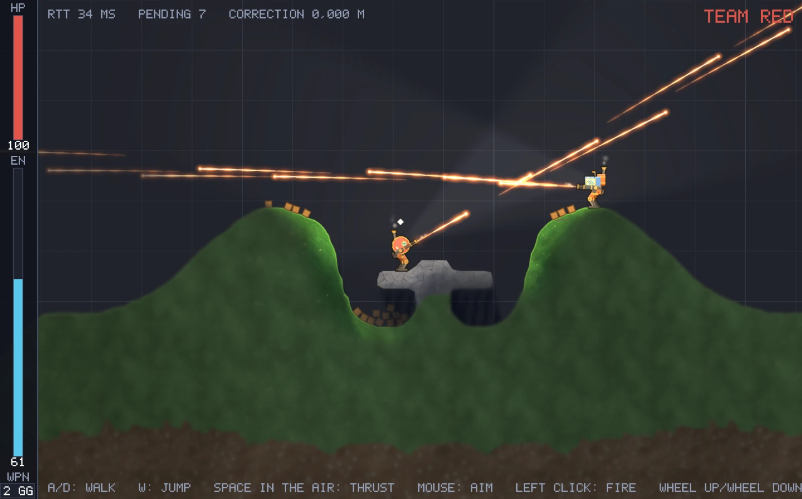
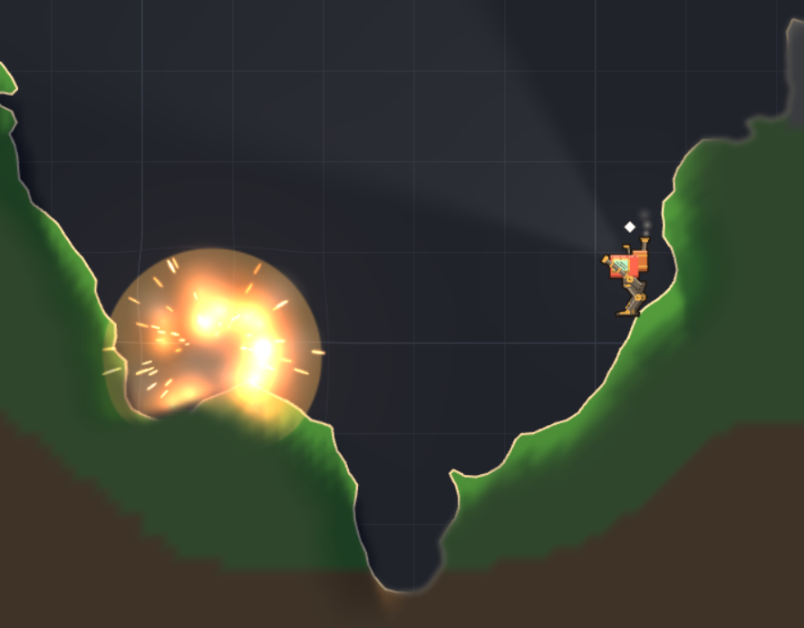

# RumbleMechs

Welcome to RumbleMechs!

RumbleMechs is a 2D side-scrolling multiplayer team PvP mech game with destructible terrain. Your team of mechs battles it out against another for dominance. Blast through hills, dig under the enemy's defenses, and build your own.

> **Early alpha.** The game is in early development: expect bugs, missing features and things changing between builds. It is free to download and play during the alpha, but RumbleMechs will **not** be free once it is released.

This repository only holds the game for download. The game's source is not public.

**Join the community on [Discord](https://discord.gg/YaeqsPCvM)**: find people to play with, report bugs and suggest
ideas.

## Features

### In the game now

- **Fully destructible terrain.** All terrain is destructible. Dig tunnels and surprise your enemy! Create a secret tunnel right into the enemy base.
- **Physics.** Mechs, crates, grenades and rounds all move by the same physics. Blow a hole in
  a wall and lob grenades through it.
- **Dig and build.** The ground is yours to reshape: tunnel under the map into the enemy's base, carve out bunkers,  or build walls and cover where you need them.
- **Fog of war.** Fog of war that is shared by the team. If the enemy can't see you, they don't know what you are doing. maybe you dig a tunnel right under their base.
- **Fast mechs.** Walk, jump and fly on your thrusters, everything uses energy and you only have a limited amount.

### Planned

- **Bases to build and defend.** Place generators, turrets and shields to protect your base, and break through the
  enemy's.
- **Your own loadout.** Build your mech to suit your playstyle: heavy or light, machine guns or grenade launchers.
- **More weapons**, destroy things even faster, bigger explosions, throw grenades that create walls of dirt to block your enemies.
- **More maps**, several more maps.
- **Control waypoints**, There will be waypoints you can control for bonuses.

## Download and play

**[Download the latest version for Windows](https://github.com/SyntaxWarrior/RumbleMechs/releases/latest/download/RumbleMechs-win-x64.zip)**

1. Unzip it anywhere.
2. Start `RumbleMechs.exe`.
3. Pick a server from the list and play.

Nothing else needs installing. Type the name you want to play under in the box above the server list (click it or
press Tab); it is kept for the next time, in `settings.yaml` next to the game.

Windows may warn that the program is from an unknown publisher, since it isn't signed. Choose **More info** and then
**Run anyway**.

### Controls

| | Keyboard and mouse | Gamepad |
|---|---|---|
| Walk | A / D | Left stick |
| Jump | W or Space | A |
| Thrusters (in the air) | Hold Space | Hold A |
| Aim | Mouse | Right stick |
| Fire | Left click | Right trigger |
| Change weapon | 1 / 2 or mouse wheel | LB / RB |
| Menu | Esc | Start |

## License

The alpha is free to download and play, but RumbleMechs is not open source, and the finished game will not be free:
see [LICENSE.txt](LICENSE.txt). It includes third-party components under their own licenses: see
[THIRD-PARTY-NOTICES.txt](THIRD-PARTY-NOTICES.txt).

Copyright (c) 2026 Jens Berfenfeldt. All rights reserved.
